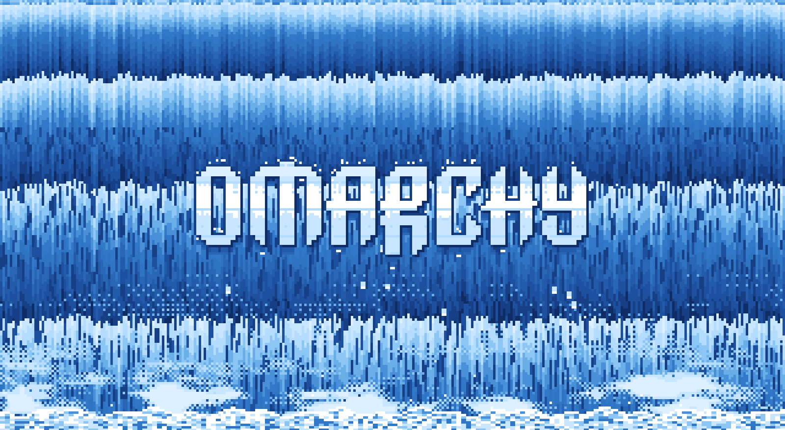
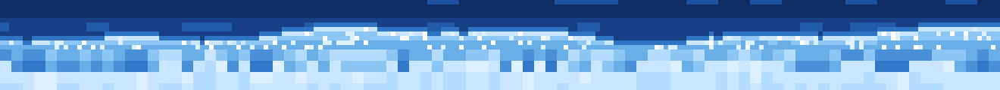

# Tidal

> Over the bar the river leans,
> a lip of light, a breath, a fall;
> in ragged bands of sapphire blue
> it quickens down the pixel wall.
> The pool below throws silver spray,
> the mist climbs slow on morning air,
> and from the veil a name comes up,
> wet stone that was not always there.
> It holds a while, then washes clear,
> and still the falling water sings:
> sixteen bits of endless blue
> above the work your morning brings.

A 16-bit waterfall for your Omarchy desktop. Your top bar becomes the brink of the falls, the water pours down the screen in ragged pixel bands, churns into a foaming pool and throws mist back up, and every so often the Omarchy wordmark rises out of the water, holds, and washes away again.



The brink, behind the bar (3x):



- **Classic tile style.** One-pixel columns of light-to-dark bands with ragged leading edges, white droplet sparkles and a churning foam pool, in a palette of saturated royal blues, the way 16-bit games drew waterfalls. No dithering in the falling water; clean colour steps.
- **The bar is the brink.** With the companion theme, your top bar turns transparent and a dark river runs behind it toward the edge, where a bright, uneven lip bulges over into the falls. Your bar's text stays readable on the dark water.
- **Real physics, in pixels.**
  - The water leaves the brink at a set speed and falls under gravity, so the bands stretch as they speed up: a parcel at height *y* has fallen for *t(y) = (sqrt(v0² + 2gy) - v0) / g*, and bands are spaced equally in that time.
  - The sheet is glassy at the brink and turbulent lower down. By continuity it thins as it speeds up, so the lower falls tear into short gaps and shed more droplets.
  - Droplets ride the water exactly (each is labelled by its fall time).
  - Slow wind gusts bend the sheet in proportion to how long it has fallen.
  - Mist is a density field that thins exponentially with height, billows up through moving turbulence and drifts with the wind. Mist droplets rise on an updraft against drag and fade as they evaporate.
  - Splash droplets leave the pool on ballistic arcs, and the pool surface heaves with travelling ripples.
  - The river's flow surges every 80 seconds, and each surge travels through the scene: the lip swells first, the extra water reaches the pool one fall time later, then the mist thickens as it rises.
- **Omarchy rises out of the water.** The stock Omarchy wordmark surfaces from the bottom rows up with a fizzing edge, water splashes off its tops and leaves a gap beneath, drops gather on its underside and fall, then it washes away. Every 80 seconds.
- **Light on the GPU.** It draws at a fifth of your screen's resolution (each art pixel is 5x5 screen pixels), scaled up with hard edges, 12 times a second. The falls pause while a fullscreen or tiled window covers the workspace; the brink keeps moving (it's always visible) until a fullscreen window hides the bar too.
- **Seamless.** Every motion is a whole number of cycles in a 16-minute loop, so it never jumps.

## Install

```bash
omarchy plugin add https://github.com/Tiedeyez/tidal.git --enable
```

Then add the companion theme and switch to it:

```bash
cp -r ~/.config/omarchy/plugins/tiedeyez.tidal/theme/tidal ~/.config/omarchy/themes/
omarchy theme set tidal
```

Tidal only draws while the Tidal theme is active, so your other themes stay exactly as they were. The theme is copied rather than installed from git because Omarchy only loads a theme's Lua file (its border colours and flat window look) from your own themes folder. The theme's `shell.bar.toml` makes the bar transparent so the brink shows through; without the theme the plugin stays off.

Tidal sits on the layer just above your normal wallpaper and below your windows, and clicks pass straight through. If you run another animated-background plugin, disable it while you use Tidal, or both will draw.

## Remove

```bash
omarchy plugin disable tiedeyez.tidal
omarchy plugin remove tiedeyez.tidal
rm -r ~/.config/omarchy/themes/tidal      # if you copied the theme
```

Switch to another theme first if Tidal is your current one.

## Settings

All optional, in Tidal's entry in `~/.config/omarchy/shell.json`; the file is watched, so a change applies at once:

```json
{ "id": "tiedeyez.tidal", "pixelSize": 5, "fps": 12, "pauseUnderWindows": true, "barWater": true, "themes": ["tidal"] }
```

| Setting | Default | What it does |
|---|---|---|
| `pixelSize` | `5` | Screen pixels per art pixel. Lower is finer and costs more. |
| `fps` | `12` | Redraws per second (1 to 30). The motion is designed for 10 to 12, like the classic tiles. |
| `pauseUnderWindows` | `true` | Hold the falls still while tiled windows fill the workspace. |
| `barWater` | `true` | Draw the brink behind the bar. Only used when the bar is at the top. |
| `themes` | `["tidal"]` | Theme names Tidal draws on; `["*"]` for every theme. |
| `clockOffset` | `0` | Start the clock this many seconds into the 960-second loop (for testing the loop point). |

The brink follows your bar's height automatically (Omarchy's own `[bar] size-horizontal`).

## Performance

Measured on a 2015 laptop with Intel HD Graphics 520 at 1600x900 (GPU busy from RC6 residency, 20-second averages):

| | GPU busy | Shell CPU (one core) |
|---|---|---|
| Tidal on an empty workspace | 25.6% | 8% |
| Same laptop, no animated background (idle floor) | ~25% | under 1% |
| Fullscreen window (Tidal paused) | 5.2% | 3% |
| Working in tiled windows (falls paused, brink moving) | +4 points over no brink | +6% |

## How it's drawn

- `Service.qml`: an Omarchy `service` plugin. One click-through surface per screen for the falls, one per screen for the brink, sharing one clock.
- `shaders/tidal.frag`: the falls, pool, mist and wordmark. `shaders/bar.frag`: the brink. Both are compiled to `.qsb` by `build.sh`, reproducibly (see [shaders/PROVENANCE.md](shaders/PROVENANCE.md)).
- `logo.png`: the 81x19 Omarchy wordmark, rasterised from Omarchy's `logo.svg`, used as the shader's stencil.
- `theme/tidal/`: the companion theme (colours, transparent bar, flat Hyprland look, recoloured Omarchy wallpaper and unlock image).
- `dev/linecheck.sh <screenshot.png> [percent]`: flags rows where one colour covers most of the width, a check for unwanted straight lines in the art.

Style notes: the techniques come from 8- and 16-bit game art: colour cycling and palette animation ([Color cycling](https://en.wikipedia.org/wiki/Color_cycling), [Mark Ferrari's Q&A](https://dcmpx.remotevs.com/com/effectgames/www/PL/effect/article-Q_A_with_Mark_J_Ferrari.html)), hue-shifted ramps and moving water ([Slynyrd Pixelblog 1](https://www.slynyrd.com/blog/2018/1/10/pixelblog-1-color-palettes), [Pixelblog 10](https://www.slynyrd.com/blog/2018/10/12/pixelblog-10-water-in-motion)), and the classic animated waterfall tile. Everything is drawn by the shader; no game or tile artwork is included.

## Disclosure

See [DISCLOSURE.md](DISCLOSURE.md): what Tidal reads (a handful of local files and Hyprland's window state), and that it writes nothing, runs no processes and uses no network.

## Credits

Built by Tiedeyez. MIT licence. The wordmark stencil and the theme's wallpaper and unlock image are the stock Omarchy artwork, recoloured; Omarchy is MIT-licensed, Copyright (c) David Heinemeier Hansson.
